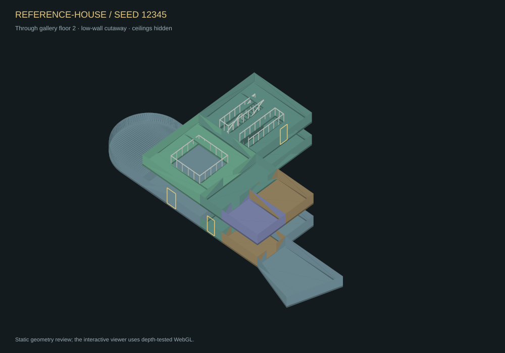

# Backrooms Zone Lab

A browser laboratory for deterministic, engine-independent finite architectural zones. **Phase 2 adds a physically validated three-storey reference house and interactive 3D inspection.** Its layout is a designed sample; seed-driven house composition is Phase 3.

The [requirements](docs/requirements.md) define the complete house milestone and future world-integration boundary. The earlier `Backrooms-Prototype-Map` repository remains unchanged.

## Current workbench

- A 17-space reference house: double-height foyer, upper gallery, service/private room groupings, curved lounge, angled winter garden, and a ground-floor circulation loop.
- Two real stair flights between three floors, with individual treads, landings, headroom, shaft holes, guards, and supporting floor surfaces.
- Actual local door apertures and configurable external door contracts; ports can occur on any of the three floors.
- Physically derived navigation, inward and return reachability, walker-width path witnesses, blocked-access diagnostics, and geometry mutation tests.
- A depth-tested WebGL whitebox viewer: orbit, pan, zoom, space picking, floor cutaways, optional ceilings, low-wall cuts, guards, and validated path overlays.
- Readable stacked floor plans with actual stair footprints, gallery holes, openings, guards, and local navigation.
- Portable `br.zone/0.2` reference plans, canonical JSON, stable IDs, fingerprints, reproducible URLs, and full plan/report downloads.
- Phase 1 line/arc studies remain available, with their unchanged `br.zone/0.1` export behavior.

The reference house has **fixed topology**. Changing its seed records a different request identity; it does not claim a new architectural recipe. The separate Phase 1 studies still vary geometric parameters by seed.

## Run and verify

Node 22 or newer is required for tooling. There are no npm or CDN runtime dependencies.

```sh
npm test
npm run batch -- 200
npm run batch:architecture
npm run build
```

Serve the repository root or `dist/` over static HTTP. Opening ES modules directly as a `file:` URL is unsupported. GitHub Pages hosts `dist/` unchanged, including under the repository subpath.

```sh
node scripts/examples.mjs
```

Refreshes reproducible plans, floor diagrams, and a static cutaway geometry review.

## Review the reference



| View | Artifact |
| --- | --- |
| Complete canonical reference plan | [JSON](docs/examples/reference-house.json) |
| Ground floor: room program and circulation loop | [Plan](docs/examples/reference-house-floor-1.svg) |
| Gallery floor: protected foyer opening and two shafts | [Plan](docs/examples/reference-house-floor-2.svg) |
| Top floor: stair arrival and private rooms | [Plan](docs/examples/reference-house-floor-3.svg) |
| Angled Phase 1 geometry | [Plan](docs/examples/angular-floor-1.svg) |
| Circular Phase 1 geometry | [Plan](docs/examples/rotunda-floor-1.svg) |

The cutaway is a static geometry review rendered from the same mesh-building code; live interaction and GPU shader behavior are separate verification steps.

## Inspection controls

The default profile is **Three-storey reference house**. Use **Through gallery floor** to inspect the double-height foyer, or **Whole building** for all three floors. Disable **Low wall cutaway** to display complete wall height; enable ceilings to inspect caps. Drag to orbit, Shift-drag or right-drag to pan, scroll to zoom, and click a surface to select its space. Arrow keys rotate, `+`/`-` zoom, and `0` resets the camera.

**Validated paths** displays geometric witnesses through the actual room floors and door thresholds. These paths are validation/debug output rather than a game navigation mesh or player controller. The inspector identifies the declared walker: 0.3 m body radius and 2.1 m headroom.

External contract JSON uses floor indices `0`, `1`, `2` for the reference house. Its supported storey rise is 2.8–3.6 m; the fixed core constrains this range. Unsupported or unrealizable requirements fail explicitly. Invalid plans can be exported with diagnostics for reproduction.

## GitHub Pages

The Pages workflow publishes changes merged to `main`. Use **Settings → Pages → Source: GitHub Actions** if hosting is not already configured. Repository visibility and account entitlements determine Pages availability. Workflows preserve visibility and existing hosting settings; a live deployment is confirmed only by GitHub's successful deployment result.

## Architecture and scope

`geometry.js` and `determinism.js` remain renderer-independent. `architecture.js` builds the designed sample; `structure.js` derives boundary surfaces, apertures, and guards; `physical.js` reconstructs validation/navigation; `navigation.js` produces exact-clearance path witnesses. `mesh.js` tessellates only for rendering, and `viewer3d.js` manages WebGL inspection. `render.js` supplies exact-arc SVG plans; `app.js` owns controls and exports.

The physical contract uses finite-thickness slabs, stepped stair bodies, and semantic zero-thickness wall boundary surfaces. Runtime collision, thick wall solid realization, structural support, navmeshes, and engine controllers are not implemented. Browser/GPU interaction QA is unavailable in the implementation environment; automated controller and rendering-data checks do not replace it.

See [Phase 2 design and validation](docs/physical-architecture.md), [implementation status](docs/status.md), [zone-plan contract](docs/zone-plan.md), and [geometry conventions](docs/geometry.md). The next phase introduces procedural house composition. Infinite zone graphs, streaming, and portal rendering remain outside the lab.
