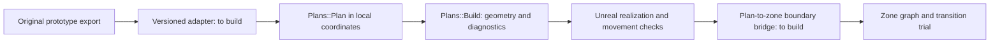

# Unreal plan compiler, grids, and zone connections

Reference snapshot: October 14, 2026. Based on the owner's local Backrooms engineering rules, implementation context and portable source, and prototype main at `71888a4196fb96ce1a317484ebb70ec36f71961e`.

This document explains the new Unreal-side architecture and what a prototype needs to preserve to connect to it. It adds no importer, generator, schema change or runtime feature. Earlier [exchange](unreal-exchange.md) and [transfer](transfer-workflow.md) documents describe a checked rectangular path; this reference records the newer polygon-plan path beside it. The desired prototype remains the starting point for transfer, as described in [design handoff](design-handoff.md).

## What changed locally

Backrooms now has a portable plan model under `Source/Backrooms/Workshop/Plan`: polygon rooms, explicit wall masses, openings as physical cuts, named levels and local placement frames. Positions are whole millimetres; rotations are whole millidegrees. Rooms may be concave, have holes or have several parts. Walls may stand at any angle with their own thickness.

`Plans::Build` compiles those inputs into surfaces, convex collision prisms and passage records. The Real Homes entry in the local Zone Lab reads `.plan.json` files, optionally rebuilds their interiors, makes a shell, adds arch beams, compiles them, and makes them walkable in Unreal.

This is a second compiler path. The older House/Level 0 templates, rectangular exchange harness and zone-transition test still use `Templates::Generate`. Their migration to the plan model is future work (R7 in the local rework roadmap). Do not apply the older template grid or Piece limits to every polygon plan, or assume that all existing generators already use the new compiler.

## Which grid means what

| Path or operation | Units and grid | Meaning for prototypes |
| --- | --- | --- |
| Existing rectangular exchange version 1 | XY in 50 cm units; heights in cm on 10 cm steps; quarter turns in the legacy placement path | Continue using this contract for that export and its existing verification harness. |
| New `Plans::Plan` | Whole mm and whole millidegrees; no compulsory architectural grid | Preserve accepted polygon outlines, wall thicknesses and opening positions at this precision. A template may choose its own spacing. |
| Real Homes outer shell | Optional `ShellStyle::grid = 500` mm; 0 disables it | The shell's outer faces are regularized in the plan's own frame. This is not a snap of every interior wall, doorway or room. |
| Interior rebuild | Configurable standard construction dimensions and bounded room growth | This deliberately changes architecture and is a separate operation from importing or compiling an unchanged plan. |
| Discovery/loading | Spatial lookup and loading units | Lookup buckets or loading boundaries must not become architectural walls or door-placement grids. |

The Real Homes screen's Outer grid dial selects 500 mm or no grid. A plan's frame can later rotate the whole plan; a shell aligned to its local axes need not align to world axes.

At an adapter boundary, convert units explicitly: one legacy XY unit is 500 mm, one cm is 10 mm, one metre is 1,000 mm, and a quarter turn is 90,000 millidegrees. Validate finite values, coordinate bounds and integer range before conversion. Use a documented deterministic rounding rule; the plan geometry's arbitrary turns round to nearest with halves away from zero. Keep source coordinates and record quantization as a conversion change. Never round a full geometry prototype onto the legacy 50 cm grid just to satisfy its validator.

## The plan data to hand over

The native plan format is `format: "backrooms-plan"`, `version: 1`; its model is `Plans::Plan`. It is distinct from both browser export families.

| Data | Native representation and connection significance |
| --- | --- |
| Placement | `frame.origin`, `frame.z`, `frame.milliDegrees`; geometry remains in the plan's local coordinates. |
| Levels | Stable id, name, elevation and height. Each space and solid names a level. |
| Spaces | Stable id, kind/title, exact polygon shape, floor offset, ceiling height, outside flag and source ids. A rectangular bound is an inspection aid, not its occupied shape. |
| Solids | Wall, column, railing or fill footprints with explicit base/top relative to their level. Empty space and solid wall volume are separate data. |
| Openings | Exact cut footprint plus sill/head relative to the level, kind, passability, optional host and the spaces `a`/`b` on either side. |
| Stairs | Levels connected, ordered flights, widths, riser counts, landings, footprint and whether the structure was inferred. Model fields alone do not establish stair realization. |
| Fixtures/start | Oriented fixture dimensions; starting space and point. Validate the start against actual support and clearance. |
| Provenance | Dataset/source revision, licence, credit, source ids and changes. Keep this through conversion and architectural transformations. |

Shapes are normalized rings: anticlockwise outer rings, clockwise holes, no repeated closing vertex, stable ring starts and ordering. Entity lists serialize in id order; ids are unique across the plan. Unknown newer format versions are refused. Preserve independent generator and schema versions rather than reinterpreting an old identity as different geometry.

For today's browser formats:

- Rectangular `backrooms-zone` version 1 continues through its existing compiler harness. An optional outline does not turn its rectangular physical checks into polygon checks.
- Full `br.zone` geometry needs a dedicated adapter mapping clear floors, actual wall solids, apertures, heights, support and identities to the native plan. Preserve the original full export.
- `br.resplan-zone/1` is a source import, as explained in [ResPlan](resplan.md). Its calibrated dimensions and assumed heights need assessment; source room adjacency and window relations cannot be promoted directly into movement connections. The local Unreal Real Homes library is Swiss Dwellings/3C-SD, not this browser ResPlan collection.

Neither renaming a file nor passing browser validation implements one of those adapters.

## How spaces connect inside a compiled plan

`Plans::Build` sorts the relevant heights into horizontal bands. In each band it unions the solids standing there and subtracts the opening cuts passing through that height. This produces walls meeting at arbitrary angles, sills and lintels, and stacked openings without one filling another.

An opening's host is descriptive when known; the cut acts on intersecting solids on its level, including overlapping wall pieces. The current builder expands a drawn opening across the wall direction by `Through = 150` mm on either side so a shallow source door does not leave a wall sliver. That finite allowance is not a guarantee for an arbitrarily thick wall: inspect the remaining solid and its collision.

Space floors and ceilings use their actual shapes. A passable opening at level sill zero gets a separate threshold floor/collision slab across the cut outside the room floors. Keep elevations explicit: this does not prove support for every raised threshold, ramp or drop.

The builder creates passage records for openings and for spaces whose shapes meet on the same level and floor. Windows and view slots must be non-passable. Required connections need an actual usable cut, floor support, complete clearance and permitted movement directions; a stored graph edge alone is insufficient.

The current plan report is diagnostic rather than a complete Human movement certificate:

- `PersonWidth = 680` mm and `PersonHeight = 1920` mm identify the body dimensions in the compiler header; narrow passable openings are counted.
- Reachability follows passable passage records regardless of narrow-door status, and starts from both the selected start and exterior entrances.
- `Build` does not consume the stair flights to generate treads or certify vertical traversal. Whole buildings with walkable stairs remain a separate roadmap step.
- A plan may be drawn/walked while still reporting problems. Successful compilation or a reached-space count does not prove every path is traversable and returnable from one arrival.

Transfer verification therefore needs geometry/collision checks and representative gameplay walks. Preserve intentional unusual geometry, but report a required movement contract that cannot yet be realized.

## Rebuild, shell and finishes are separate decisions

Real Homes currently applies these operations in this order:

1. Read the source plan.
2. If requested, `RebuildInterior`: grow rooms into wall mass to find middle lines, give back half a standard wall, keep solid cores unless deliberately collapsed, and set doors again. Its default inner wall is 120 mm. Rooms that were open to each other remain open.
3. `MakeShell`: standardize heights and make a Follow or Box shell, with optional outer grid, balconies and windows. Default outer wall thickness is 300 mm; openings extend by slots to its outer face, and a roof slab closes it.
4. Find open doorways and add arch beams, then `Plans::Build`.
5. Realize surfaces/collision in Unreal; apply floor lays and joinery from the accepted geometry.

A rebuild that would destroy a room leaves the original interior and reports why. Rebuild and shell choices can move boundaries, alter room area and change openings. They are explicit architectural choices, not invisible importer repairs; carry their settings and reports beside the original prototype.

`PlanFloors` lays wood through joined rooms, centers tile room by room and carries one side's finish through a doorway. `PlanTrim` fits casing/reveals and baseboards to openings; its glass is solid. These are presentation operations and must not change the accepted circulation. Arch beams, however, are added before physical compilation.

Current source versions: Format 1, Build 4, Rebuild 1, Shell 1, Floors 2, Trim 2 and Arches 1. These are component versions, not a declaration of browser-generator parity.

## How whole zones will connect

The engineering contract defines a zone by its boundary: stated door frames and sizes, a start, an outer bound, supported walkable space, matching collision and deterministic regeneration. Its interior may be polygonal or otherwise specialized. An entrance opportunity is not already a cut opening or a graph edge.

The existing transition trial demonstrates two ways to connect whole zones:

- **Joined passages:** both zones lay the same connector in its own frame; each draws and collides only with the part it owns. Align the endpoint frames and elevations, then show the zones as a continuous place. The test can reposition a hidden zone to the requested passage; it does not require every zone in a graph loop to fit in one permanent spatial embedding.
- **Portal doors:** a real aperture and portal frame at each end connect zones standing elsewhere. Unreal handles the view and player transform. A portal needs actual opening geometry, not just an entrance label.
- **Vertical passages:** the sample includes a ramp and a one-way drop with a return route elsewhere. Their rise and permitted direction belong to the connector.

These are implemented in the legacy `ZoneTestVersion 5` trial, not automatically provided to every imported polygon plan. The local context still lists connecting lab templates to each other as unfinished; their entrance opportunities are named but uncut. The trial does not replace the endless route world by declaration.

The inferred integration path is:



For that future boundary bridge, preserve the owning space/opening ids, threshold position, outward facing and up, clear width/sill/head, approach footprint and depth, floor elevation/support, traversal family and direction, plus required/optional status. This is an integration checklist, not a new implemented JSON schema.

Place or pair zones through those accepted frames. Apply unit conversions and complete rotations at the bridge; do not reuse a legacy quarter-turn helper for an arbitrary-angle plan. Both ends must agree on the usable aperture and ownership. When a chosen connector does not fit, try bounded deterministic alternatives or report failure; never silently drop a required link.

## What to preserve while prototyping

Keep curved and angled walls, shaped floors, solid masses, opening locations, vertical intent and the rules/dials that produced them. The polygon kernel can carry a faceted representation of curved intent; the native plan format has no analytic arc primitive. Preserve original arcs as design data and report the chosen approximation/tolerance or missing capability.

The older straight-edge door restriction is a limitation of that particular construction path. It is not evidence that Unreal cannot contain curved walls. A curved-face opening still needs a deliberate adapter, cut, support and clearance test; support for every such door is not established by the new model.

Deliver the original geometry, seed/dials, generator source and dependencies, stable ids/versions, rules with explicit relaxation thresholds, provenance and a validation report. Keep physical safety and required connectivity independent of architectural rules that Strangeness may relax.

For the first transfer, compile a fixed chosen layout before porting its generator. Compare geometry and movement, including negative coordinates, order-independent compilation, wall/collision agreement, all required openings, vertical support and outward/return paths. Record unsupported features by entity id and extend the Unreal side for useful designs. Preserve the last accepted result when a conversion or proposed change fails.

## Source basis and evidence limits

Read-only local sources for this snapshot:

- `AGENTS.md`: plan location, zone boundary contracts, deterministic identity, accepted geometry, connection ownership and loading rules.
- `CONTEXT.md`, “Now” / real architectural data and the finite-zone and Zone Lab trial sections.
- `Tools/PlanFormat.md` and `Tools/RealPlansRework.md`: file semantics, adopted precision and remaining roadmap work.
- `Source/Backrooms/Workshop/Plan/PlanModel.h`, `PlanGeometry.h`, `PlanBuild.h/.cpp`, `PlanRebuild.h`, `PlanShell.h`, `PlanFloors.h`, `PlanTrim.h` and `PlanArches.h`.
- `Source/Backrooms/Workshop/ZoneLabRealHomes.cpp`, `ZoneTest.h` and `Source/Backrooms/Explore/WorldPatchActor.cpp`: current pipeline, transition contracts and realization.

The local context records portable library checks and rendered Real Homes tours, alongside unresolved narrow/source doors, rebuild fallbacks and some triangulation problems. Its older headline date and legacy world sections lag those newer entries. Source definitions were checked for this document; no Unreal build, portable suite or gameplay walk was rerun. Those recorded results do not establish native validation of current browser exports.

Primary source SHA-256 values at review time (raw local bytes):

```text
AGENTS.md  BB2D322BCAF240C53D4C379E5DCE788BD9F1DD509583E8B0BBE24E651EA1895D
CONTEXT.md FC00584EBF00EA01CA0B09C965C1740700DD78E2F7787945FA30302820660E7C
```
